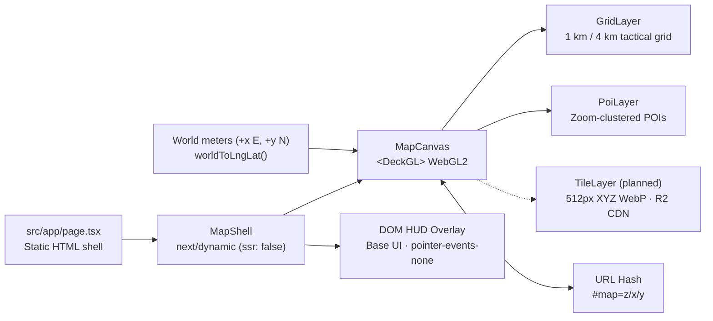

<p align="center">
  <a href="https://viatlas.netlify.app">
    <picture>
      <source media="(prefers-color-scheme: dark)" srcset="docs/brand/vi-gradient-on-dark.png">
      <source media="(prefers-color-scheme: light)" srcset="docs/brand/vi-gradient-on-light.png">
      
    </picture>
  </a>
</p>

<h1 align="center">Viatlas</h1>

<p align="center">
  <a href="https://github.com/bubb4rd/viatlas/actions/workflows/ci.yml"></a>
  <a href="https://viatlas.netlify.app"></a>
  
  
  
  <a href="LICENSE"></a>
</p>

<p align="center">An interactive tactical map of Leonida for Grand Theft Auto VI — top-down 2D and pitched 3D in the browser.</p>

<p align="center">
  <a href="#features">Features</a> ·
  <a href="#data-and-provenance">Data &amp; provenance</a> ·
  <a href="#getting-started">Getting started</a> ·
  <a href="#architecture">Architecture</a> ·
  <a href="#roadmap">Roadmap</a> ·
  <a href="#contributing">Contributing</a>
</p>

Most game maps feel like generic web GIS tools draped over a flat image. Viatlas is built to feel like an in-world tactical pause map: a glassy diegetic HUD over a GPU-rendered WebGL2 canvas, north-up 2D by default, with a smooth transition into pitched 3D when orientation or elevation adds context.

Because Leonida isn't on Earth, Viatlas runs with no third-party basemap. Every grid line, clustered point of interest, and upcoming raster tile lives in a flat world-meter coordinate system (`+x` east, `+y` north) mapped onto a synthetic Web Mercator extent, with camera views shareable directly through the URL hash.

> [!IMPORTANT]
> **Unofficial fan project.** Not affiliated with, endorsed by, or connected to Rockstar Games or Take-Two Interactive. _Grand Theft Auto_ and related marks belong to Take-Two Interactive. The project neither uses nor accepts game files, leaked material, or official assets—all map artwork is original and every location requires a cited public source. See the [data & assets policy](docs/data-and-assets.md).

## Features

### Tactical 2D & 3D camera

- **Top-down first, 3D on demand.** Starts north-up in 2D for speed and readability, with a `600 ms` interpolated transition to a pitched 3D view (`50°` pitch, `-20°` bearing) that unlocks drag and touch rotation.
- **HUD camera buttons.** Zoom in, zoom out, and reset view (home position, north-up) are keyboard-operable buttons, so the camera never depends on scroll or drag alone.
- **Zero per-frame React re-renders.** The deck.gl camera runs uncontrolled and mirrors its latest pose in a ref, keeping pan and zoom locked to the GPU render loop.
- **Diegetic HUD & tactical grid.** Translucent glass panels sit over a `1 km` minor / `4 km` major reference grid (`24 km × 32 km` world bounds). HUD containers pass drags through (`pointer-events-none`) and follow WCAG 2.2 AA targets (`44 px` minimum touch targets, visible focus rings, `prefers-reduced-motion` support).

### Clustered POIs & layer filtering

- **In-house GPU clustering.** A custom deck.gl `CompositeLayer` (`PoiLayer`) merges markers within a `48 px` screen radius and recomputes only when crossing integer zoom levels—no external clustering dependency and no React work on zoom.
- **Interactive Intel Layers popover.** Built on [Base UI](https://base-ui.com) with live per-category counts, quick reset, and an opt-in switch for speculative locations (hidden by default).
- **POI detail sheet.** Selecting a marker opens a non-modal panel with its category, world position, confidence, and source citation, plus a copy-link button for the deep link. `Escape` or the close button dismisses it and clears the selection.
- **Keyboard POI list.** A toggleable HUD panel lists exactly the markers the active filters show, grouped by category. Arrow keys, Home, and End move between entries; picking one selects it and flies the camera there.

| Category       | Color token                | Source file                                            |
| -------------- | -------------------------- | ------------------------------------------------------ |
| **Landmarks**  | `#ff5f8f` (Leonida sunset) | [`data/pois/landmark.json`](data/pois/landmark.json)   |
| **Businesses** | `#ffb84d`                  | [`data/pois/business.json`](data/pois/business.json)   |
| **Activities** | `#a78bfa`                  | [`data/pois/activity.json`](data/pois/activity.json)   |
| **Transport**  | `#60a5fa`                  | [`data/pois/transport.json`](data/pois/transport.json) |
| **Nature**     | `#4ade80`                  | [`data/pois/nature.json`](data/pois/nature.json)       |

### Shareable URL state

Every map view is a static link stored in the URL hash, so navigating or sharing never triggers a Next.js route transition:

- **2D camera:** `#map=zoom/x/y` (e.g. `#map=12.50/1200/-3400`)
- **3D camera:** `#map=zoom/x/y/pitch/bearing` (e.g. `#map=13.00/0/0/50/-20`)
- **Filters & selection:** `#hide=<categories>`, `#speculative=1`, and `#poi=<id>` restore the Intel Layers filter and the selected POI on load and on `hashchange`.
- **Deep-link helpers:** [`src/features/map/url-state.ts`](src/features/map/url-state.ts) parses and serializes every key while preserving unknown hash keys and clamping out-of-range values. Camera updates debounce `250 ms` after motion settles via `replaceState`.

### Zero-dependency POI search

[`src/features/search/poi-search.ts`](src/features/search/poi-search.ts) provides a pure client-side search index with accent-, case-, and punctuation-insensitive multi-token matching across POI names, aliases, and categories. Results rank deterministically by match quality and confidence while strictly respecting active category and speculative filters. _(HUD search bar wiring is in progress for Phase 1.)_

## Data and provenance

Every point of interest in [`data/pois/`](data/README.md) must cite a verifiable public source (`trailer`, `screenshot`, `official-site`, `in-game`, or an openly licensed `community` source with URL and license) and declare a confidence level (`confirmed`, `likely`, or `speculative`). Invented locations, leaked footage, and game-extracted assets are never accepted.

```json
{
  "id": "poi-example-lighthouse",
  "name": "Example Lighthouse",
  "category": "landmark",
  "position": [1250, -3400],
  "source": {
    "kind": "trailer",
    "ref": "Trailer 2 @ 01:23",
    "addedBy": "github-handle"
  },
  "confidence": "confirmed"
}
```

`pnpm check` validates every file in `data/pois/` against the schema, world bounds, provenance fields, category/file matching, and globally unique `poi-*` IDs—so malformed data fails CI with exact file and index errors before it can merge.

Want to add or correct a location? Read [`docs/data-and-assets.md`](docs/data-and-assets.md) and [`data/README.md`](data/README.md), or open a [Map data issue](https://github.com/bubb4rd/viatlas/issues/new?template=map-data.yml) with your source.

## Getting started

### Requirements

| Tool                    | Version                             | Notes                                   |
| ----------------------- | ----------------------------------- | --------------------------------------- |
| **Node.js**             | `24` (pinned in [`.nvmrc`](.nvmrc)) | Engines: `^22.22.2 \|\| >=24.15.0`      |
| **pnpm**                | `9.15.9`                            | Managed via Corepack (`packageManager`) |
| **Playwright Chromium** | Latest bundled                      | Only needed for `pnpm test:e2e`         |

### Local development

```bash
git clone https://github.com/bubb4rd/viatlas.git
cd viatlas
nvm use
corepack enable
pnpm install        # installs dependencies and lefthook git hooks
pnpm dev            # starts Turbopack dev server at http://localhost:3000
```

### Scripts

| Command                         | What it does                                                                   |
| ------------------------------- | ------------------------------------------------------------------------------ |
| `pnpm dev`                      | Local dev server (Next.js Turbopack)                                           |
| `pnpm check`                    | **PR gate:** Biome lint, TypeScript typecheck, and Vitest unit/component tests |
| `pnpm test` / `pnpm test:watch` | Run Vitest suite once / in watch mode                                          |
| `pnpm test:e2e`                 | Playwright smoke tests (`pnpm exec playwright install chromium` once)          |
| `pnpm build` / `pnpm start`     | Production build / serve locally                                               |
| `pnpm analyze`                  | Interactive Next.js bundle analyzer                                            |
| `pnpm lint:fix`                 | Autofix Biome lint and formatting issues                                       |
| `pnpm typecheck`                | Run `next typegen` and `tsc --noEmit`                                          |

## Architecture

Viatlas ships a prerendered Next.js 16 static HTML shell first, then lazy-loads the client-only WebGL2 map chunk behind a `next/dynamic(..., { ssr: false })` boundary. Coordinates stay in world meters throughout the codebase and convert via `worldToLngLat` only at the deck.gl layer boundary.



### Tech stack

| Concern             | Choice                                                      | Notes                                                                |
| ------------------- | ----------------------------------------------------------- | -------------------------------------------------------------------- |
| **Framework**       | Next.js 16 (App Router), React 19, React Compiler           | Static shell; Cache Components enabled                               |
| **Map engine**      | deck.gl 9 (WebGL2)                                          | Standalone GPU layers; no third-party basemap                        |
| **Coordinates**     | World meters → synthetic Web Mercator (`0°, 0°`)            | 1 projected meter = 1 world meter                                    |
| **Styling**         | Tailwind CSS v4 + CSS tokens                                | Diegetic HUD palette in [`src/app/globals.css`](src/app/globals.css) |
| **UI primitives**   | Base UI (`@base-ui/react`)                                  | Accessible popovers, switches, focus management                      |
| **Tooling & QA**    | pnpm, Biome, Vitest, Playwright, lefthook, GitHub Actions   | Strict TS (`noUncheckedIndexedAccess`), commit hooks                 |
| **Hosting & tiles** | Netlify (app + PR previews) · Cloudflare R2 (planned tiles) | Immutable versioned 512 px WebP tiles off-app                        |

### Repository layout

```text
src/app/                 Thin App Router shell, metadata, and design tokens (globals.css)
src/features/map/        MapShell, MapCanvas, camera modes, world math, URL state, GridLayer
src/features/pois/       POI schema & validator, clustering, category filter popover, PoiLayer
src/features/search/     Pure multi-token POI search index and deterministic ranker
data/pois/               Reviewed, source-cited POI JSON arrays (one file per category)
scripts/                 Repo and data pipeline tooling (commit-msg hook validator)
e2e/                     Playwright smoke specs
docs/                    Vision, architecture, standards, data policy, brand marks, ADRs
```

### Performance budgets

Performance is treated as a product feature. PRs touching rendering or dependencies include `pnpm analyze` output or a Chrome Performance trace against these ceilings ([`docs/standards.md`](docs/standards.md#performance-budgets)):

| Metric                             | Budget                                                      |
| ---------------------------------- | ----------------------------------------------------------- |
| **Shell LCP**                      | `< 1.5 s` on mid-range mobile over fast 4G                  |
| **JS before map chunk**            | `< 120 KB` gzip                                             |
| **Map chunk (`deck.gl` + layers)** | `< 350 KB` gzip                                             |
| **Pan / zoom frame rate**          | `60 fps` on M1-class laptop · `≥ 45 fps` on mid-range phone |
| **Long tasks during interaction**  | None over `50 ms`                                           |
| **Raster base tiles**              | `≤ 100 KB` per 512 px WebP tile                             |

<details>
<summary><b>Architecture decision records (ADRs)</b></summary>

| #                                                 | Decision                                        | Status   |
| ------------------------------------------------- | ----------------------------------------------- | -------- |
| [0001](docs/adr/0001-deckgl-without-basemap.md)   | deck.gl standalone, no third-party basemap      | Accepted |
| [0002](docs/adr/0002-world-coordinates.md)        | World meters on a synthetic Web Mercator extent | Accepted |
| [0003](docs/adr/0003-toolchain.md)                | pnpm, Biome, Vitest, Playwright, lefthook       | Accepted |
| [0004](docs/adr/0004-poi-data-and-clustering.md)  | POI data as validated JSON, clustered in-house  | Accepted |
| [0005](docs/adr/0005-base-ui-primitives.md)       | Base UI for interactive HUD primitives          | Accepted |
| [0006](docs/adr/0006-netlify-deployment.md)       | Netlify for app hosting and PR deploy previews  | Accepted |
| [0007](docs/adr/0007-base-tiles-and-cdn.md)       | Static 512px XYZ WebP base tiles on R2 CDN      | Accepted |
| [0008](docs/adr/0008-data-and-artwork-license.md) | CC BY-SA 4.0 for map data and original artwork  | Accepted |

</details>

## Roadmap

| Phase                | Scope                                                                                                                         | Status      |
| -------------------- | ----------------------------------------------------------------------------------------------------------------------------- | ----------- |
| **0 · Foundation**   | Repo setup, standards, CI, static shell, WebGL2 map canvas, 2D/3D camera                                                      | Done        |
| **1 · Usable map**   | URL-synced camera & hash state, clustered POIs, category filters, POI search, base tile pyramid & `TileLayer`, touch controls | In progress |
| **2 · 3D**           | Terrain heightmap (`TerrainLayer`), extruded landmarks, time-of-day `LightingEffect`                                          | Planned     |
| **3 · Living world** | `TripsLayer` traffic and routes, opt-in Explore mode (fog of war), waypoints, local collections                               | Planned     |

See [`docs/vision.md`](docs/vision.md) for the full design pillars, deck.gl layer references, and explicit non-goals.

## Contributing

Contributions—code, original map artwork, and sourced POI data—are welcome. Viatlas uses a trunk-based workflow on `main` with automatic Netlify Deploy Previews on every pull request.

- Run `pnpm check` before opening a PR (and `pnpm test:e2e` for UI or rendering changes).
- Commit subjects and PR titles follow `scope: outcome` (lowercase scope, ≤ 72 chars, no trailing period), enforced by lefthook and CI.
- AI-assisted contributions are welcome and held to the same review bar as hand-written code; coding agents must follow [`AGENTS.md`](AGENTS.md).

**Documentation:** [`Vision`](docs/vision.md) · [`Architecture`](docs/architecture.md) · [`Standards`](docs/standards.md) · [`Data & assets`](docs/data-and-assets.md) · [`ADRs`](docs/adr/README.md) · [`Brand assets`](docs/brand/README.md) · [`Contributing`](CONTRIBUTING.md) · [`Agent rules`](AGENTS.md) · [`Code of Conduct`](CODE_OF_CONDUCT.md) · [`Security`](SECURITY.md)

## License

Code is licensed under [Apache-2.0](LICENSE). Reviewed map data and original artwork are licensed under [CC BY-SA 4.0](https://creativecommons.org/licenses/by-sa/4.0/) ([ADR-0008](docs/adr/0008-data-and-artwork-license.md)); see the [data & assets policy](docs/data-and-assets.md#licensing).
